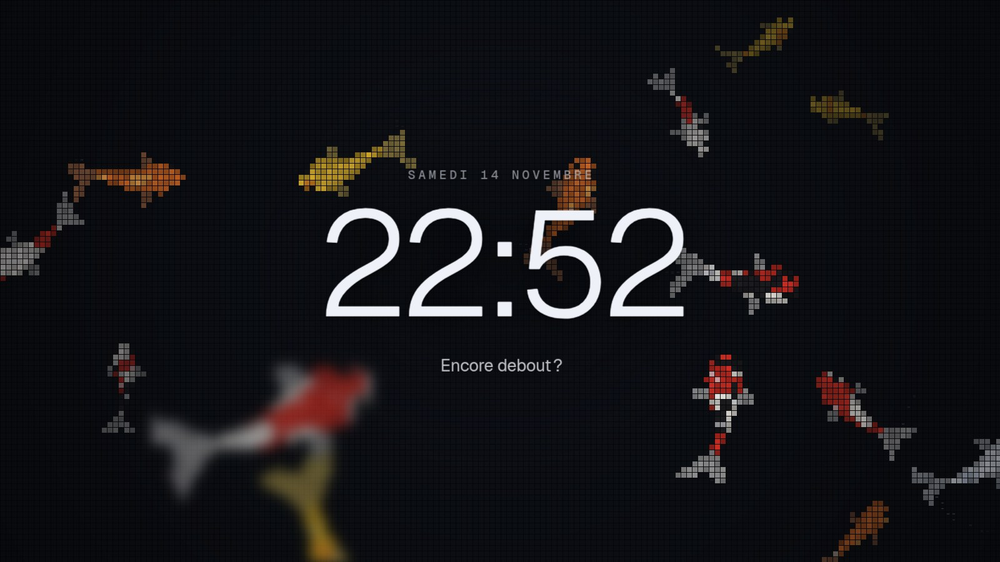

# ASCII Animals Screensaver

A screensaver for the GNOME desktop environment. Animals drawn with pixels and
ASCII characters move across the screen, behind a clock and the date.



## Origin

This project is an adaptation of the Chrome extension
[ASCII Animals New Tab](https://github.com/Pawan-webdeveloper/Ascii-Animals-extension),
developed by [Pawan-webdeveloper](https://github.com/Pawan-webdeveloper) and
released under the MIT License.

The seven animations of the original extension (butterflies, koi, jellyfish,
dragonflies, frogs, cranes and crabs) are included without modification. The
search bar has been removed and the clock has been enlarged.

## Compatibility

| System | Status |
| --- | --- |
| Debian 13 with GNOME | Tested |
| Ubuntu 24.04 with GNOME | Installation verified; not tested in a desktop session |
| Other desktop environments (KDE Plasma, Cinnamon, Xfce, etc.) | Can be installed; automatic start is not supported |

## Installation

1. Download the `.deb` file from the
   [latest release page](https://github.com/Elthrai377/ascii-animals-screensaver/releases/latest).
2. Open a terminal in the folder that contains the file and run the following
   command:
   ```bash
   sudo apt install ./ascii-animals-screensaver_*_all.deb
   ```
   The required dependencies are installed automatically.
3. Launch **ASCII Animals Screensaver** from the applications menu to enable
   the screensaver. It is then enabled automatically each time you log in.

## Usage

The screensaver appears after three minutes of inactivity. It closes as soon as
a key is pressed, a mouse button is clicked or the mouse is moved.

It does not appear while an application prevents the screen from going idle,
for example during video playback, or while the session is locked.

The **ASCII Animals Screensaver** application lets you configure:

- the idle delay before the screensaver appears;
- the animal displayed, or a random choice, and how often it changes;
- the language (English or French) and the time format (12-hour or 24-hour);
- the appearance and movement of the animals.

## Notes

- By default, GNOME turns the screen off after five minutes of inactivity
  (**Settings › Power › Screen Blank**). The screensaver delay must be shorter
  than this value; otherwise, the screensaver never appears.
- The screensaver does not lock the session: it closes without asking for a
  password. Locking remains handled by GNOME.

## Updating and uninstalling

To update the application, install the new `.deb` file using the procedure
described above.

To uninstall it, run the following command:

```bash
sudo apt remove ascii-animals-screensaver
```

## License

This project is released under the [MIT License](LICENSE). The original code is
© 2026 Pawan-webdeveloper; the adaptation is © 2026 Elthrai377.

The [Geist and Geist Mono](https://vercel.com/font) fonts are © Vercel and
released under the SIL Open Font License 1.1.
